# 🚗 AutoDiag · Copilote Mécanique Intelligent

Application web complète de diagnostic automobile grand public, combinant un **moteur décisionnel déterministe ISO 14229** (zéro hallucination), un **catalogue automobile multi-sources** (`MySQL`, `gor3a`, `NHTSA vPIC`, `@meterapp/vehicle-db`), des **guides de vérification technique avec schémas SVG dynamiques** et un **assistant mécanique IA bilingue (FR / EN)** avec garde-fou de sécurité intégré.

---

## 📸 Aperçu de l'Application (Mode Sombre & Mode Clair)

### 1. Accueil & Grille des 64 Symptômes (`/`)
Filtrage instantané par catégorie mécanique, recherche intelligente, véhicule actif et accès direct à l'assistant IA ou au diagnostic guidé.

| Mode Sombre | Mode Clair |
| :---: | :---: |
| 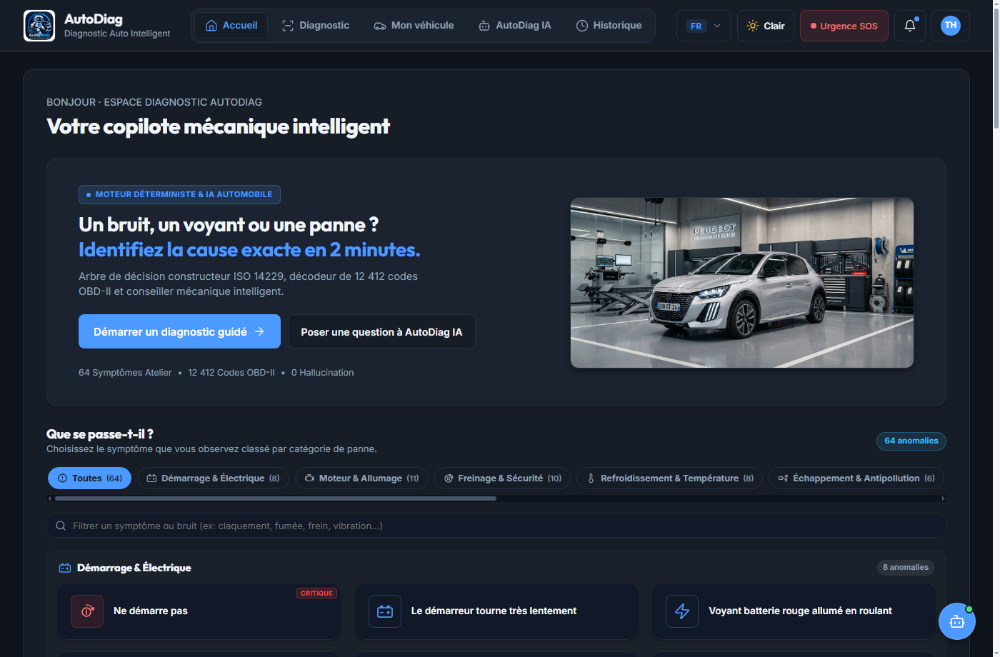 | 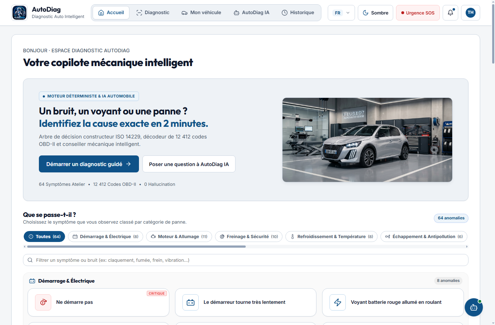 |

---

### 2. Mon Véhicule & Garage Multi-Sources (`/vehicle`)
Gestion multi-véhicules avec logos constructeurs, sélection **Marque → Modèle → Année → Carburant → Motorisation** (sans filtrage abusif sur les carburants) alimentée par 164+ marques (`gor3a`, `NHTSA vPIC`, `MeterApp`).

| Mode Sombre | Mode Clair |
| :---: | :---: |
| 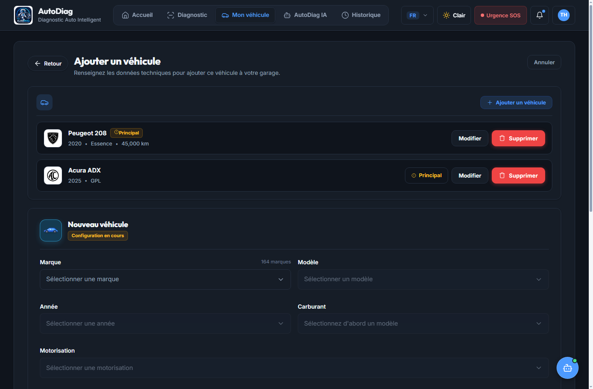 | 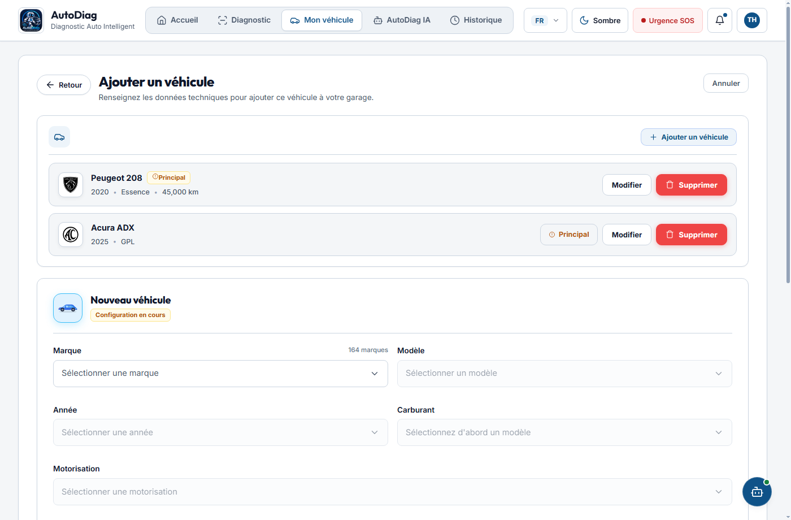 |

---

### 3. Diagnostic Guidé d'Atelier (`/diagnostic/:sessionId`)
Arbre décisionnel étape par étape avec critères de conformité constructeur, protocoles de vérification sur véhicule, contrôle strict de la sécurité et défilement automatique vers le constat suivant.

| Mode Sombre | Mode Clair |
| :---: | :---: |
| 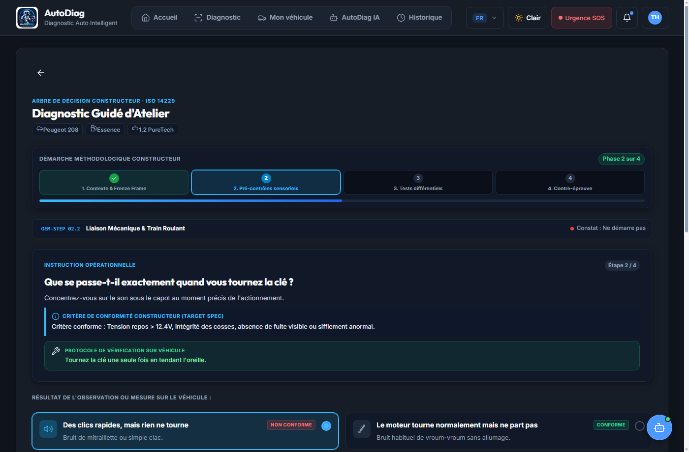 | 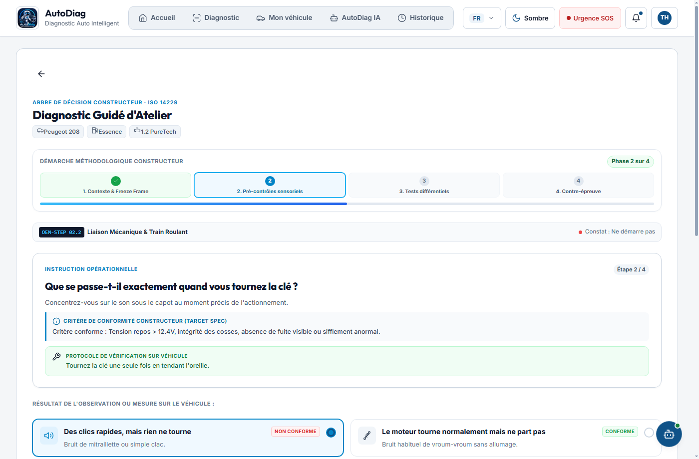 |

---

### 4. Rapport d'Expertise & Pistes de Panne (`/results/:sessionId`)
Synthèse pondérée par le moteur de scoring (probabilités, sous-systèmes AMDEC, criticité opérationnelle, explication vulgarisée sans jargon et redirection directe vers l'assistant IA).

| Mode Sombre | Mode Clair |
| :---: | :---: |
| 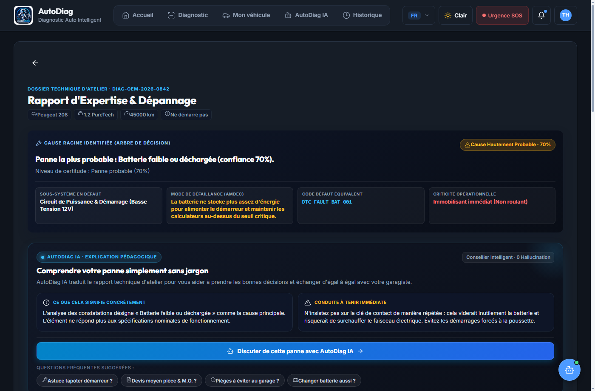 | 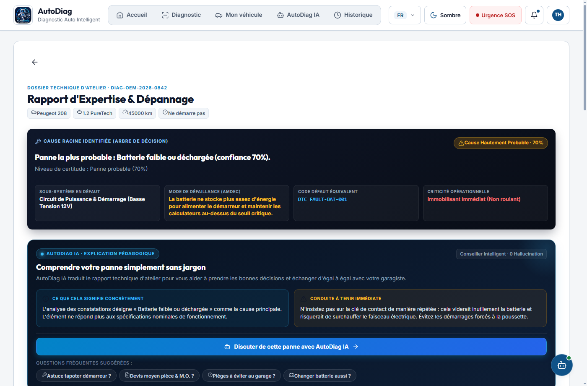 |

---

### 5. Guide de Vérification & Schémas SVG Dynamiques (`/guide/:guideId`)
15 illustrations vectorielles techniques dédiées adaptées automatiquement au composant inspecté : **batterie (12.64V), bougies d'allumage, pompe à carburant (3.8 bar), freins, démarreur, alternateur, refroidissement, capteur ABS, fusibles, filtre à air, huile moteur, pneus TPMS, échappement, courroie, multimètre**.

| Mode Sombre | Mode Clair |
| :---: | :---: |
| 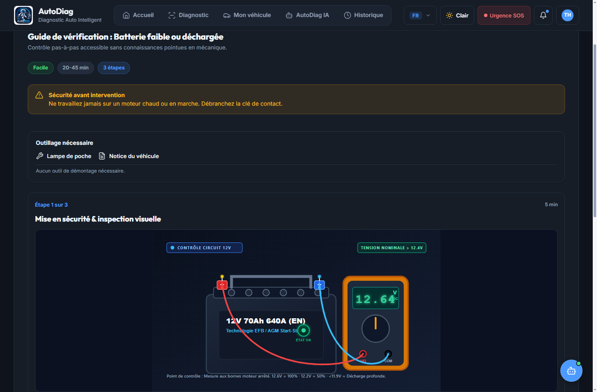 | 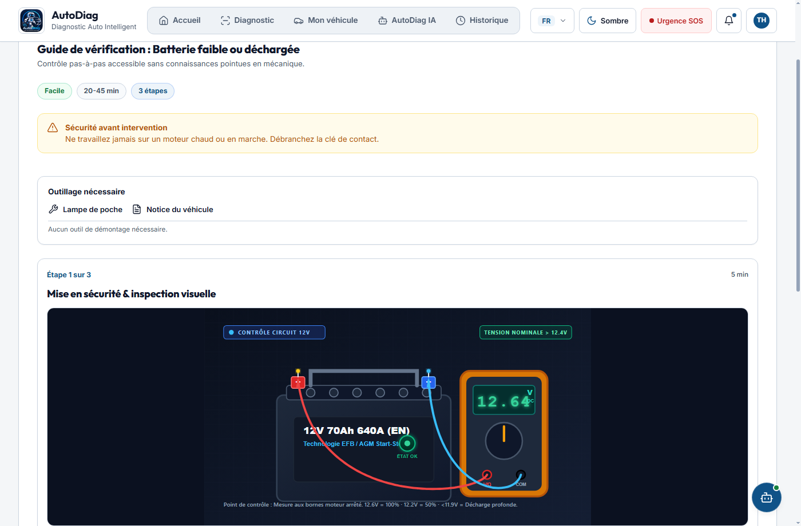 |

---

### 6. Assistant Mécanique AutoDiag IA (`/assistant`)
Conseiller conversationnel relié au contexte exact du véhicule actif et à la base technique certifiée MySQL (détection automatique des requêtes vagues/imprécises, alertes danger vital, estimation chiffrée des réparations, support Groq / DeepSeek / OpenRouter / OpenAI / Local).

| Mode Sombre | Mode Clair |
| :---: | :---: |
| 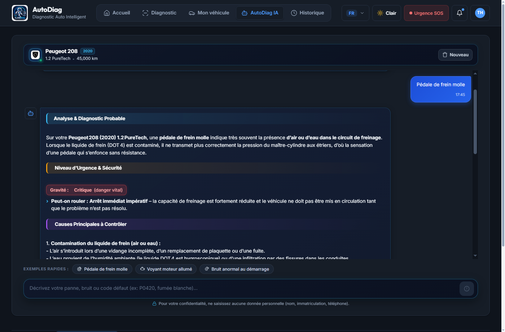 | 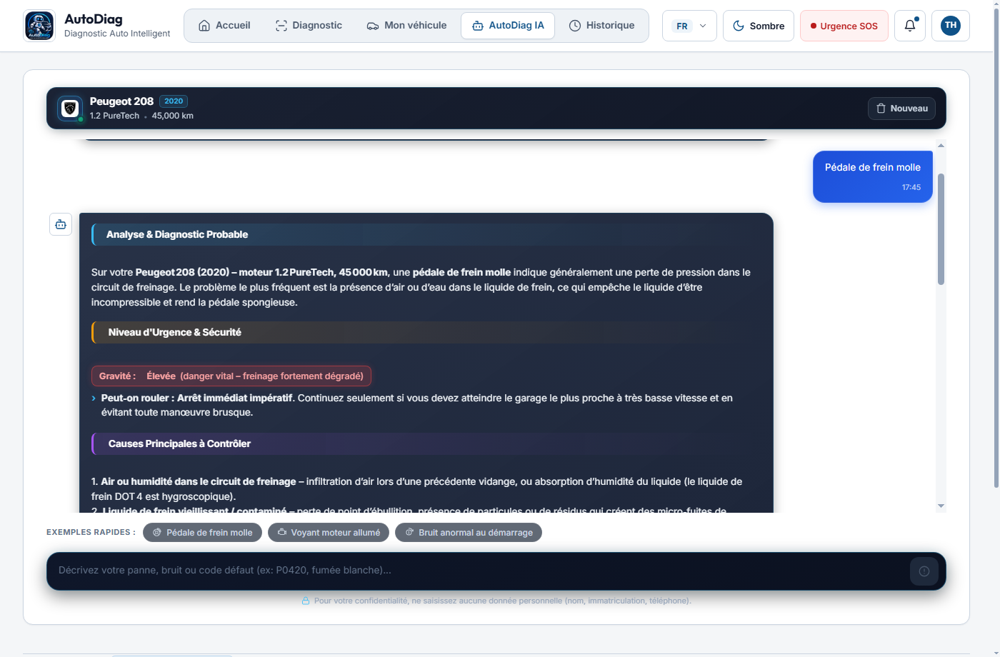 |

---

### 7. Historique des Diagnostics & Carnet d'Entretien (`/garage`)
Suivi chronologique des diagnostics passés et en cours pour chaque véhicule du garage, associé au carnet d'entretien numérique.

| Mode Sombre | Mode Clair |
| :---: | :---: |
| 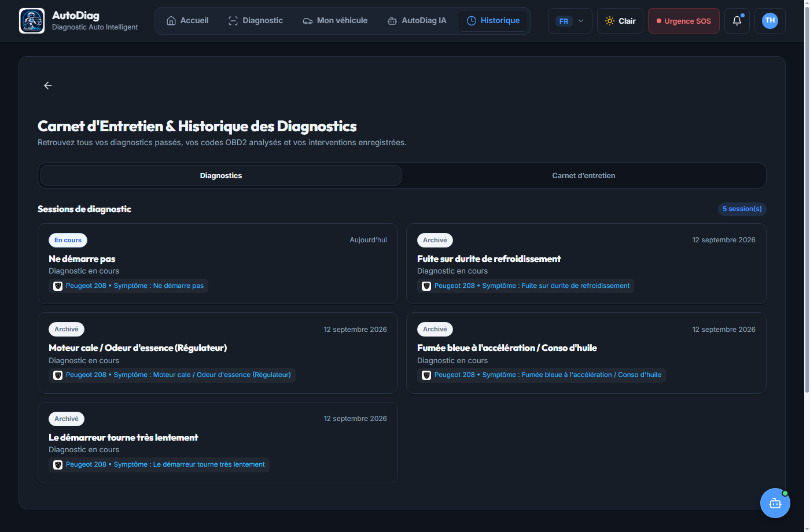 | 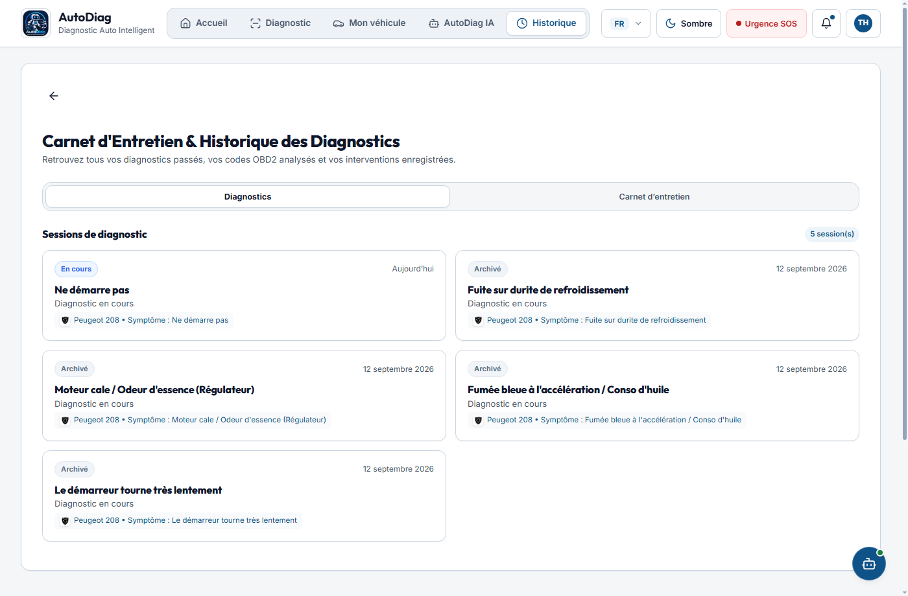 |

---

## 🏗️ Architecture Technique

```
┌────────────────────────────────────────────────────────┐
│               Frontend: Angular 20.3                   │
│  • Composants Standalone & Signaux                     │
│  • Bilingue FR / EN dynamique                          │
│  • Thème Sombre / Clair synchronisé + WCAG AA          │
│  • Chatbot flottant global & Responsive Desktop/Mobile │
└──────────────────────────┬─────────────────────────────┘
                           │ HTTP REST API
                           ▼
┌────────────────────────────────────────────────────────┐
│            Backend: Node.js + Express 5                │
│  • Moteur de diagnostic déterministe & scoring         │
│  • Garde-fou de sécurité (Safety Guard)                │
│  • Catalogue multi-sources (MySQL, gor3a, NHTSA, DB)   │
│  • Résolution sémantique des schémas de tests SVG      │
│  • Sécurité : Helmet CSP, CORS, Rate Limiting, gzip    │
└──────────────────────────┬─────────────────────────────┘
                           │ mysql2 / SQL
                           ▼
┌────────────────────────────────────────────────────────┐
│              Base de Données: MySQL                    │
│  • Schéma relationnel complet (`autodiag_dev`)         │
│  • Symptômes, arbres décisionnels, hypothèses, guides, │
│    codes défaut OBD-II, catalogue véhicules & garage   │
└────────────────────────────────────────────────────────┘
```

---

## 🚀 Démarrage Rapide

### 1. Prérequis
- **Node.js** (v18+ recommandé) & **npm**
- **MySQL / MariaDB** démarré en local sur le port `3306`

### 2. Configuration de l'environnement
Copiez le fichier d'exemple dans `backend/` et ajustez vos identifiants si nécessaire :
```bash
cp backend/.env.example backend/.env
```

### 3. Démarrer le Backend
```bash
cd backend
npm install
npm start
```
Le serveur Node.js démarre sur **`http://localhost:3000`**, vérifie/initialise automatiquement le schéma MySQL et charge les données techniques.

### 4. Démarrer le Frontend Angular
```bash
cd frontend
npm install
npm start
```
L'application Angular est accessible sur **`http://localhost:4200`**.

---

## ✨ Fonctionnalités Clés
- **Bilingue FR / EN complet** : Changement de langue instantané depuis la barre supérieure.
- **Thème Clair / Sombre** : Persistance automatique des préférences utilisateur (`localStorage` + `prefers-color-scheme`).
- **Bouton Urgence SOS** : Consignes d'arrêt et numéros d'urgence accessibles à tout moment.
- **Zéro Hallucination** : Les diagnostics guidés s'appuient exclusivement sur des règles et arbres décisionnels déterministes vérifiés en base MySQL.
