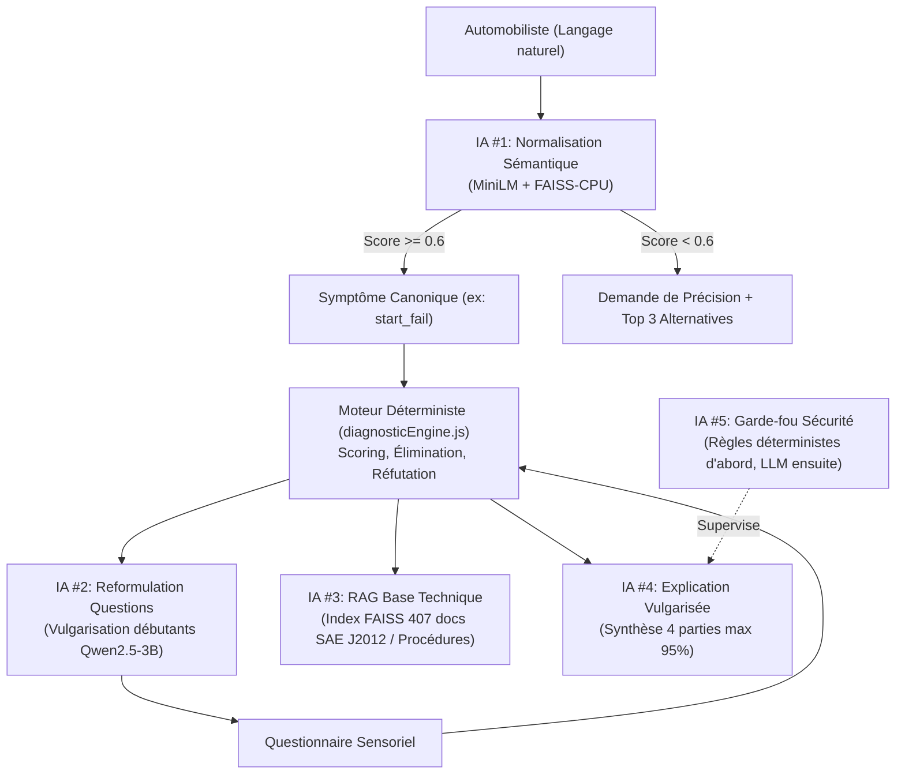

# Architecture de la Couche IA Locale — AutoDiag

## 1. Principes Directeurs et Garde-fous

1. **Souveraineté Déterministe** :
   Le moteur déterministe (`diagnosticEngine.js`) reste **le seul et unique décisionnaire** sur le diagnostic technique, l'ordre des tests et les alertes de sécurité vitale.
   L'intelligence artificielle n'a aucun pouvoir de décision sur les pannes ; son rôle exclusif est le **traitement du langage naturel** (compréhension d'expressions libres, vulgarisation, reformulation, recherche contextuelle).

2. **100 % Local & Hors-ligne** :
   Aucun appel vers des API cloud tierces (OpenAI, Anthropic, etc.). Tous les calculs s'exécutent localement sur CPU.

3. **Tolérance aux Pannes & Fallback Systématique** :
   Si le runtime IA est indisponible, surchargé ou en échec, un fallback déterministe immédiat prend le relais avec le flag `fallback_applied: true`. L'application ne bloque jamais l'utilisateur.

---

## 2. Vue d'Ensemble des 5 Modules IA



---

## 3. Module IA #1 — Normalisation Sémantique des Symptômes

* **Objectif** : Mapper une phrase libre de l'utilisateur (ex. : *"ma voiture fait des clics et rien ne tourne"*) vers l'un des symptômes canoniques indexés.
* **Modèle d'embedding** : `sentence-transformers/paraphrase-multilingual-MiniLM-L12-v2` (dimension 384, optimisé multilingue et français).
* **Indexation** : `faiss.IndexFlatIP` (produit scalaire sur vecteurs normalisés L2 = similarité cosinus exacte).
* **Seuil de confiance** : `0.60`.
  * Si $\text{score} \ge 0.60$ : identification automatique du symptôme (`symptom_id`, `code`, `label`).
  * Si $\text{score} < 0.60$ : `needs_clarification: true`, le système demande une reformulation et propose les 3 alternatives les plus proches.
* **Fallback déterministe** : Moteur par mots-clés et racines lexicales (`démarr`, `voyant`, `bruit`, `fumé`, `chauff`, `frein`, `batterie`).

### Schéma de Réponse API (`POST /api/normalize-symptom`)
```json
{
  "symptom_id": 1,
  "code": "start_fail",
  "label": "Ne démarre pas",
  "category": "Démarrage",
  "score": 0.8632,
  "needs_clarification": false,
  "message": null,
  "threshold": 0.6,
  "top_3_alternatives": [
    { "symptom_id": 1, "code": "start_fail", "label": "Ne démarre pas", "score": 0.8632 },
    { "symptom_id": 6, "code": "brakes", "label": "Freins", "score": 0.6951 },
    { "symptom_id": 8, "code": "electric", "label": "Problème électrique", "score": 0.6163 }
  ],
  "fallback_applied": false
}
```

---

## 4. Module IA #2 — Reformulation des Questions pour Débutants

* **Objectif** : Traduire le jargon technique issu du diagnostic en constat sensoriel (ce que l'utilisateur entend, voit, sent ou ressent).
* **Runtime** : `llama-cpp-python` (version 0.3.36, roues officielles Windows CPU pré-compilées).
* **Modèle local** : `Qwen2.5-3B-Instruct Q4_K_M` (~2.09 Go GGUF).
* **Règle absolue de Fallback** : Si le LLM n'est pas présent, met plus de 4 secondes ou échoue, le système retourne immédiatement la question originale (avec indice pédagogique si disponible) avec `fallback_applied: true`. L'application n'est jamais bloquée.

### Schéma de Réponse API (`POST /api/reformulate-question`)
```json
{
  "original_question": "Le démarreur entraîne-t-il le volant moteur normalement ?",
  "reformulated_question": "Pour débutant : entendez-vous le démarreur lancer le moteur avec force ou fait-il seulement un bruit de clic ?",
  "explanation_hint": "Le démarreur est le moteur électrique qui lance le moteur quand vous tournez la clé.",
  "fallback_applied": true
}
```

---

## 5. Module IA #3 — RAG sur la Base Technique Locale

* **Objectif** : Recherche documentaire et contextuelle à travers les pannes physiques (`faults`), les fiches de tests sans démontage (`diagnostic_tests`), les solutions chiffrées (`solutions`), et le référentiel des codes défauts OBD-II (`dtc_codes`).
* **Traçabilité des Sources** : Chaque passage indexé conserve son identifiant source (`source_id`), le nom du référentiel (`source_name`), la licence (`license`) et la version (`version`) :
  * *AutoDiag Workshop Heuristics* (Source ID 2, licence Proprietary / CC-BY-NC-SA 4.0).
  * *SAE J2012 / ISO 15031-6 Standard OBD-II Database* (Source ID 1, licence MIT).
* **Indexation FAISS** : Index `IndexFlatIP` à 384 dimensions (`data/faiss_index/tech_docs.index`, 407 vecteurs) avec métadonnées complètes (`tech_docs_meta.json`).
* **Seuil de similarité par défaut** : `0.25`.

### Schéma de Réponse API (`POST /api/retrieve-context`)
```json
{
  "query": "batterie déchargée démarreur",
  "passages": [
    {
      "doc_id": "fault-FAULT-BAT-001",
      "doc_type": "fault",
      "fault_code": "FAULT-BAT-001",
      "title": "Batterie faible ou déchargée",
      "content": "PANNE TECHNIQUE [FAULT-BAT-001] : Batterie faible ou déchargée...",
      "score": 0.7621,
      "source_id": 2,
      "source_name": "AutoDiag Diagnostic Sensory Trees & Workshop Heuristics",
      "license": "CC-BY-NC-SA 4.0",
      "version": "4.2",
      "metadata": {
        "cost_min": 80,
        "cost_max": 200,
        "is_danger": false
      }
    }
  ],
  "total": 1,
  "fallback_applied": false
}
```

---

## 6. Module IA #4 — Génération d'Explication en Langage Clair

* **Objectif** : Générer une synthèse diagnostique pour un automobiliste néophyte en intégrant le contexte technique récupéré par le RAG.
* **4 SECTIONS STRICTEMENT OBLIGATOIRES** :
  1. 🔍 **CE QUI SE PASSE** : Exactement 1 phrase simple compréhensible par un profane absolu.
  2. 🎯 **CAUSE PROBABLE** : Explication du mécanisme en 2 à 3 phrases sans jargon obscur.
  3. 🔧 **QUOI FAIRE** : Liste ordonnée de la solution la moins chère / plus simple à la plus chère, avec estimations chiffrées en euros (€).
  4. ⚠️ **ATTENTION** : Consigne de sécurité claire indiquant quand s'arrêter et contacter un professionnel.
* **GARDE-FOU CONFIANCE (Hard Cap 95%)** :
  * La confiance affichée ne doit **JAMAIS dépasser 95%** (`min(confidence, 95)`). L'IA ne peut jamais prétendre à une certitude absolue à distance.
* **Fallback Déterministe** : Si le LLM est indisponible ou malformé, les 4 sections sont générées de manière fiable à partir des tables `faults`, `solutions` et gabarits atelier avec `fallback_applied: true`.

### Schéma de Réponse API (`POST /api/explain-diagnosis`)
```json
{
  "fault_code": "FAULT-BAT-001",
  "fault_name": "Batterie faible ou déchargée",
  "explanation": "🔍 CE QUI SE PASSE :\nVotre véhicule présente un dysfonctionnement lié à : batterie faible ou déchargée...",
  "sections": {
    "what_is_happening": "Votre véhicule présente un dysfonctionnement lié à : batterie faible ou déchargée.",
    "probable_cause": "Le circuit électrique ou le démarreur ne parvient pas à transmettre l'énergie nécessaire pour faire tourner le vilebrequin...",
    "what_to_do": "1. Contrôle visuel préliminaire sans démontage (0€).\n2. Intervention ciblée ou remplacement pièce : estimation entre 80€ et 200€.\n3. Diagnostic approfondi en atelier avec valise électronique (60€ à 120€).",
    "warning": "Ne forcez jamais le démarreur plus de 5 secondes consécutives. En cas d'odeur de brûlé ou de fumée, stoppez tout et contactez l'assistance."
  },
  "confidence": 88,
  "source_citations": [
    {
      "source_id": 2,
      "source_name": "AutoDiag Diagnostic Sensory Trees & Workshop Heuristics",
      "license": "CC-BY-NC-SA 4.0",
      "version": "4.2"
    }
  ],
  "fallback_applied": true
}
```

---

## 7. Organisation des Dossiers Livrables

```
├── app/
│   └── ai/
│       ├── __init__.py
│       ├── main.py                  # Point d'entrée FastAPI (port 8001)
│       ├── embeddings/              # IA #1 : Normalisation sémantique
│       │   ├── __init__.py
│       │   ├── service.py           # SymptomNormalizer & FAISS
│       │   └── router.py            # POST /api/normalize-symptom
│       ├── reformulation/           # IA #2 : Reformulation pour débutants
│       │   ├── __init__.py
│       │   ├── service.py           # QuestionReformulator & llama_cpp
│       │   └── router.py            # POST /api/reformulate-question
│       ├── rag/                     # IA #3 : RAG documentaire technique
│       │   ├── __init__.py
│       │   ├── service.py           # TechRAGRetriever & FAISS
│       │   └── router.py            # POST /api/retrieve-context
│       ├── explanation/             # IA #4 : Explication vulgarisée (4 sections, max 95%)
│       │   ├── __init__.py
│       │   ├── service.py           # DiagnosisExplainer & templates
│       │   └── router.py            # POST /api/explain-diagnosis
│       └── safety/                  # IA #5 : Garde-fou sécurité (à venir Étape 6)
├── data/
│   ├── canonical_symptoms.json      # Référentiel des symptômes
│   ├── tech_documents.json          # Référentiel unifié des documents techniques
│   └── faiss_index/                 # Index FAISS CPU + métadonnées (symptoms & tech_docs)
├── scripts/
│   ├── download_models.py           # Téléchargement & mise en cache locale
│   ├── build_index.py               # Construction de l'index des symptômes
│   ├── export_rag_documents.js      # Exportation MySQL vers tech_documents.json
│   └── build_rag_index.py           # Construction de l'index FAISS RAG
└── tests/
    ├── test_embeddings.py           # 10 tests (IA #1)
    ├── test_reformulation.py        # 7 tests (IA #2)
    ├── test_rag.py                  # 8 tests (IA #3)
    └── test_explanation.py          # 7 tests (IA #4)
```
