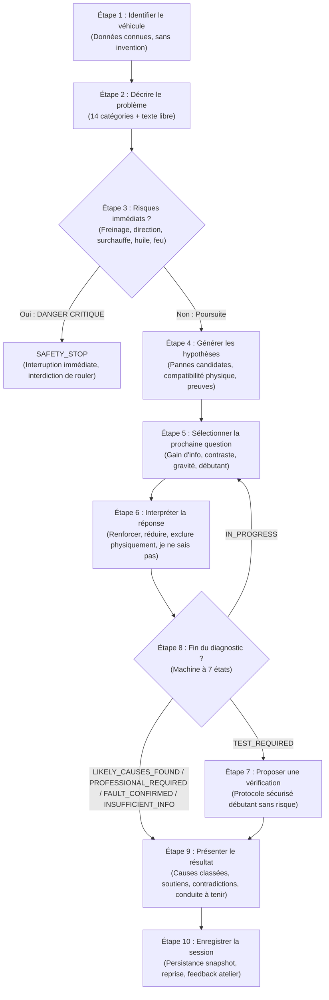

# Architecture Logique du Moteur de Diagnostic AutoDiag

Ce document décrit en détail l'architecture logique du moteur de diagnostic d'AutoDiag, décomposée en **10 étapes distinctes et séquentielles**.

---

## Vue d'Ensemble des 10 Étapes

---

## Détail des 10 Étapes

### Étape 1 — Identifier le véhicule
* **Objectif** : Recueillir les informations connues pour contextualiser le diagnostic sans jamais extrapoler de fausses informations.
* **Attributs recueillis** :
  - Marque (`brand`)
  - Modèle (`model`)
  - Année de mise en circulation (`year`)
  - Motorisation (`engine` / `engine_code`)
  - Type de carburant (`fuel` : Essence, Diesel, Hybride, Électrique)
  - Boîte de vitesses (`gearbox` : Manuelle, Automatique, Robotisée)
  - Kilométrage approximatif (`mileage`)
  - Informations complémentaires (historique d'entretien, interventions récentes)
* **Garde-fou strict** : L'utilisateur est autorisé à ignorer les données qu'il ne maîtrise pas. Si une information est inconnue, elle reste à `null` et le moteur ne filtre pas arbitrairement sur cette base. **Aucune caractéristique technique n'est inventée**.

---

### Étape 2 — Décrire le problème
* **Objectif** : Capter la manifestation initiale de la panne.
* **14 Catégories Canoniques Sélectionnables** :
  1. `start_fail` : Le véhicule ne démarre pas
  2. `stall_after_start` : Le moteur démarre puis cale
  3. `power_loss` : Perte de puissance
  4. `unusual_noise` : Bruit inhabituel (claquement, sifflement, grondement)
  5. `vibrations` : Vibrations anormales
  6. `smoke_exhaust` : Fumée anormale (noire, blanche, bleue)
  7. `overheating` : Surchauffe moteur
  8. `warning_light` : Voyant allumé au combiné
  9. `braking_issue` : Problème de freinage
  10. `steering_issue` : Problème de direction
  11. `abnormal_consumption` : Consommation anormale de carburant ou d'huile
  12. `fluid_leak` : Fuite de liquide visible sous le véhicule
  13. `electrical_issue` : Problème électrique / accessoires
  14. `other_symptom` : Autre symptôme
* **Champ libre & Normalisation** : L'utilisateur peut saisir sa description en langage naturel. Le texte brut original est scrupuleusement archivé dans `raw_user_description` tandis qu'une normalisation lexicale identifie les catégories sous-jacentes.

---

### Étape 3 — Vérifier les risques immédiats (Safety First & Safety Stop)
* **Objectif** : Détecter en priorité absolue les situations de danger vital ou de destruction mécanique imminente AVANT tout diagnostic ordinaire.
* **Règles d'arrêt d'urgence (`SAFETY_STOP`)** :
  1. **Perte d'efficacité du freinage** : Pédale molle allant au plancher, absence d'assistance, témoin STOP rouge.
  2. **Direction assistée bloquée ou incontrôlable** : Risque d'accident immédiat.
  3. **Voyant de pression d'huile rouge allumé avec bruits anormaux** : Risque de casse moteur irrémédiable en quelques secondes.
  4. **Surchauffe importante** : Aiguille dans le rouge, vapeur sous le capot. Interdiction formelle d'ouvrir le vase d'expansion à chaud (danger de brûlures au 3ème degré).
  5. **Fumée abondante sous le capot ou odeur persistante d'essence/gasoil** : Risque d'incendie majeur.
  6. **Fuite active de carburant**.
* **Consigne impérative** : **Ne JAMAIS demander à l'utilisateur de conduire pour reproduire un symptôme dangereux**. Déclencher immédiatement l'interruption `SAFETY_STOP` avec consignes d'immobilisation sécurisée.

---

### Étape 4 — Générer les premières hypothèses
* **Objectif** : Établir la liste des pannes candidates à partir du symptôme et de la motorisation.
* **Structure d'une hypothèse** :
  - Identifiant unique (`fault_id`) et code standardisé (`FAULT-***`)
  - Description accessible
  - Symptômes compatibles connus
  - Symptômes contradictoires
  - Compatibilité mécanique avec le véhicule :
    * `compatible`
    * `incompatible` : Exclusion physique ferme (ex: bougies d'allumage sur Diesel, EVAP sur Diesel, embrayage sur 100% électrique).
    * `frequent` : Modèles ou motorisations ayant une récurrence documentée.
  - Éléments de preuve et niveau de validation (`evidence_level = 'verified'` ou `'unverified'`)
  - Source technique documentée
  - Niveau de gravité (Critique, Élevée, Moyenne, Faible)
  - Tests diagnostiques de terrain associés
* **Garde-fou** : Aucune règle empirique n'est présentée comme une certitude mécanique infaillible.

---

### Étape 5 — Sélectionner la prochaine question
* **Objectif** : Sélectionner la question la plus pertinente pour discriminer les causes candidates.
* **Critères algorithmiques de sélection** :
  1. **Gain d'information & Contraste** : Capacité à maximiser l'écart entre les hypothèses en compétition active.
  2. **Gravité des pannes** : Priorité aux questions qui permettent d'écarter un danger ou une casse onéreuse.
  3. **Accessibilité débutant** : Bonus accordé aux questions reposant sur une simple observation visuelle ou auditive sans danger.
  4. **Non-redondance** : Exclusion stricte des questions déjà posées.
* **Confiance qualifiée** : Les poids des règles ne sont pas assimilés à des probabilités mathématiques arbitraires. Le moteur utilise 4 niveaux qualitatifs :
  - **Très probable** : Forte convergence d'indices concordants.
  - **Probable** : Piste principale solide.
  - **Plausible** : Piste secondaire à vérifier.
  - **Incertain** : Données insuffisantes pour trancher.

---

### Étape 6 — Interpréter la réponse
* **Options standard obligatoires** :
  - Réponses simples et factuelles (ex: "Claquement sec", "Silence", "Tourne normalement")
  - « Je ne sais pas »
  - « Je ne peux pas vérifier » (outillage manquant, météo, contrainte physique)
  - « Aucun de ces choix »
  - « Autre »
* **Effets d'une réponse** :
  - `reinforce` : Renforce le score des hypothèses compatibles (+ poids).
  - `reduce` : Atténue la priorité d'une piste sans l'éliminer.
  - `exclude` : Écarte définitivement une cause UNIQUEMENT sur critère technique strict.
  - `branching` : Oriente vers une sous-question ciblée (`next_question_id`).
  - `safety_check` : Déclenche une alerte de sécurité.
* **Règle d'or** : **Une absence de réponse ou un « Je ne sais pas » ne constitue JAMAIS une preuve d'absence de panne**.

---

### Étape 7 — Proposer une vérification (Protocole Débutant)
* **Objectif** : Fournir une vérification pratique, sensorielle et sécurisée au particulier.
* **Structure du protocole** :
  - Objectif précis du test
  - Matériel nécessaire (chiffon, lampe torche de smartphone, aucun outillage invasif)
  - Niveau de difficulté (Débutant / Moins de 3 minutes)
  - Prérequis de sécurité (moteur éteint, froid, frein à main serré, surface plane)
  - Instructions étape par étape
  - Résultats possibles et interprétation de chaque issue
  - Critères stricts nécessitant un professionnel
* **Interdictions formelles** :
  - Ne jamais recommander de manipulation sous tension électrique dangereuse.
  - Ne jamais conseiller de se glisser sous un véhicule maintenu uniquement par un cric.
  - Ne jamais ouvrir un circuit de refroidissement à chaud.
  - Ne jamais démonter un organe de sécurité (étriers, flexibles, airbags, rotules).

---

### Étape 8 — Déterminer la fin du diagnostic (Machine à 7 États)

Le moteur classe la session dans exactement l'un des **7 états formels** suivants :

| Statut | Définition & Conditions de Déclenchement |
| :--- | :--- |
| **`IN_PROGRESS`** | Le diagnostic est en cours, des questions pertinentes restent à poser. |
| **`LIKELY_CAUSES_FOUND`** | Des causes hautement plausibles ont été isolées avec cohérence. |
| **`TEST_REQUIRED`** | Deux hypothèses majeures restent en balance et un test sensoriel simple doit les départager. |
| **`PROFESSIONAL_REQUIRED`** | Intervention ou outillage professionnel indispensable (valise OBD, pont élévateur, prise de compression). |
| **`INSUFFICIENT_INFORMATION`** | L'utilisateur n'a pas pu vérifier ou a répondu « Je ne sais pas », empêchant toute convergence fiable. |
| **`SAFETY_STOP`** | Interruption immédiate du parcours pour des raisons de sécurité vitale ou risque d'incendie. |
| **`FAULT_CONFIRMED`** | Panne formellement confirmée par un test probant et concluant. **Jamais attribué par simple classement !** |

---

### Étape 9 — Présenter le résultat
* **Contenu du rapport conducteur** :
  - Causes classées avec libellé de priorité (`Piste principale`, `À envisager`, `Autre piste`).
  - Éléments qui soutiennent chaque hypothèse (`supporting_evidence`).
  - Éléments qui la contredisent ou restent inconnus (`contradicting_or_unknown`).
  - Contrôles réalisés et résultats constatés.
  - Vérifications complémentaires requises.
  - Niveau de gravité et estimation indicative des coûts.
  - Conduite à tenir claire (peut-on rouler jusqu'au garage ou faire remorquer ?).
  - Sources techniques de référence.
  - **Fiche de liaison mécanicien (« Quoi dire au garagiste »)** : Synthèse claire et concise facilitant le dialogue en atelier sans jargon obscur.

---

### Étape 10 — Enregistrer la session
* **Traçabilité complète** :
  - Identité du véhicule (données connues et inconnues tracées)
  - Symptômes initiaux et description libre originale
  - Historique chronologique des questions et réponses
  - Progression et évolution des scores à chaque étape
  - Résultats des vérifications sensorielles
  - État final du diagnostic (parmi les 7 états)
  - Corrections et confirmations éventuelles de l'atelier
* **Reprise de session (`is_resumable`)** : Toute session au statut `IN_PROGRESS` ou `TEST_REQUIRED` peut être reprise à tout moment à l'étape exacte où l'utilisateur l'avait laissée.

---

## 3. Démarche Méthodologique Professionnelle OEM (Guided Fault Finding)

Pour dépasser le format réducteur d'un simple « questionnaire grand public », le parcours de diagnostic applique la méthodologie industrielle des constructeurs automobiles (PSA DiagBox, Renault Clip, VAG ODIS, Bosch ESI[tronic]) structurée en **4 phases opérationnelles strictes** :

| Phase OEM | Intitulé Méthodologique | Objectif & Consignes d'Atelier | Données & Spécifications (Target Spec) |
| :--- | :--- | :--- | :--- |
| **Phase 1** | **Contexte Opérationnel & Freeze Frame** | Déterminer avec exactitude la fenêtre thermique, cinématique et environnementale où la panne se manifeste. | Régime moteur (ralenti, pleine charge), température d'eau (&lt;40°C, 90°C), météo, comportement des voyants combiné (fixe, clignotant, rouge STOP). |
| **Phase 2** | **Pré-contrôles Sensoriels Préliminaires** | Éliminer les anomalies physiques évidentes et garantir la sécurité avant toute mesure invasive. | Contrôle visuel direct (durites dépression, cosses batterie serrées/oxydées, fuites fraîches), contrôle auditif à la mise sous contact (sifflement pompe 2s, relais principal). |
| **Phase 3** | **Arbre Différentiel & Mesures Ciblées** | Isoler le sous-système défaillant par des instructions de test avec critères de conformité binaires (Pass/Fail). | Test de rotation démarreur avec critère de conformité nominale (&gt;200 tr/min, tension &gt;10.0V). Chaque résultat élimine formellement une branche de l'arbre. |
| **Phase 4** | **Contre-Épreuve de Validation** | Valider formellement la cause racine par un test de certitude physique avant tout ordre de remplacement de pièce. | Mesure de tension directe borne 50 du solénoïde, permutation croisée bougie/bobine, déconnexion forcée du capteur pour cartographie refuge. |

### Livrable Technique : Ordre de Réparation Atelier (OR) & AMDEC
À l'issue du diagnostic, le conducteur et l'atelier disposent d'une **Fiche d'Ordre de Réparation Normée** comprenant :
1. **Référence officielle du dossier** (ex: `DIAG-OEM-2026-0842`) conforme ISO 14229 / UDS.
2. **Organe défaillant & Mode de défaillance AMDEC** (ex: *Usure des balais ou collage solénoïde* vs *Court-circuit faisceau*).
3. **Code DTC équivalent** (ex: `DTC P0615 - Circuit commande démarreur`).
4. **Bilan d'élimination différentielle** : Tableau traçant les organes testés et formellement écartés vs cause racine confirmée.
5. **Barème temps constructeur** (UT / heures) et outillage spécifique nécessaire.
6. **Protocole de contrôle qualité post-intervention** (Cycles de démarrage à chaud/froid, effacement et relecture mémoire défauts).
